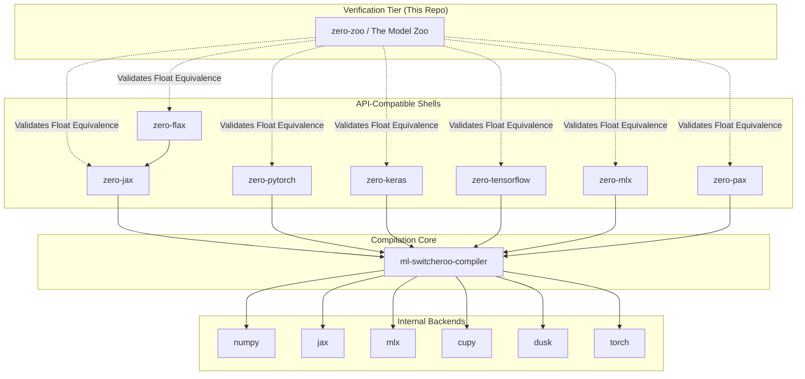

# `zero-zoo` Architecture: The Proving Grounds

**Repository Context:** This document details the specific architectural design and testing methodologies within the `zero-zoo` repository. 

While the [`zero-*`](https://github.com/SamuelMarks?tab=repositories&q=zero-) API-compatible shells and the [`ml-switcheroo-compiler`](https://github.com/SamuelMarks/ml-switcheroo-compiler) ecosystem provide the tools to trace, compile, and execute machine learning models across multiple frontends and backends, **`zero-zoo` provides the mathematical guarantees.** 

It acts as the verification layer, utilizing a vast **zoo of models** to ensure complete parity between our custom ML toolchain and industry-standard native frameworks.

---

## 1. Architectural Philosophy: The $N \times M$ Translation

The Abstract ML ecosystem traces $N$ frontends down to an IR, and executes them on $M$ backends. This creates an immense surface area for numerical bugs, subtle API drift, and gradient accumulation errors. 

To solve this, `zero-zoo` adopts a **black-box equivalence architecture**. We define complex models (MLPs, CNNs, Transformers) natively in multiple standard ML "dialects", then define the exact same models using our `zero-*` proxy APIs. We inject identical seeds and inputs into both, step them forward and backward, and assert identical outputs.

### The Ecosystem Components
- **The $N$ Frontends (Tested Here):** [`zero-flax`](https://github.com/SamuelMarks/zero-flax), [`zero-jax`](https://github.com/SamuelMarks/zero-jax), [`zero-keras`](https://github.com/SamuelMarks/zero-keras), [`zero-mlx`](https://github.com/SamuelMarks/zero-mlx), [`zero-pax`](https://github.com/SamuelMarks/zero-pax), [`zero-pytorch`](https://github.com/SamuelMarks/zero-pytorch), and [`zero-tensorflow`](https://github.com/SamuelMarks/zero-tensorflow).
- **The Core Compiler:** [`ml-switcheroo-compiler`](https://github.com/SamuelMarks/ml-switcheroo-compiler).
- **The $M$ Internal Backends:** The compiler allows routing execution through multiple internal backends to perform the actual math: `numpy`, `jax`, `mlx`, `cupy`, `dusk`, and `torch`.

## 2. The Model Zoo Directory

To provide comprehensive coverage of ML operations, the current working directory houses a literal **zoo of models**. 

For every architecture, we provide implementations in all supported **native dialects**:
- **Flax NNX**
- **Flax Linen**
- **Pax**
- **JAX**
- **PyTorch**
- **TensorFlow**
- **Keras**

The canonical architectures currently in the zoo include:
- **MLP (`mlp.py`):** Tests fundamental dense matrix multiplications, basic activations, and linear layers.
- **CNN (`cnn.py`):** Tests spatial operations, pooling layers, padding parity, and NCHW/NHWC layout transformations.
- **NanoGPT (`nanogpt.py`):** Tests complex tensor permutations, causal masking, softmax numerics, and embedding layer gradients.
- **Gemma & Qwen (`gemma.py`, `qwen.py`):** Tests advanced LLM specific operations like RoPE (Rotary Position Embeddings), KV-Caching behavior, and SwiGLU activations.

## 3. Core Testing Components

The repository is structured around three primary testing paradigms.

### 3.1 The Matrix Runner (`matrix_runner.py`)
Because our dialects have different execution paradigms (eager object-oriented in PyTorch, pure functional in JAX), the Matrix Runner normalizes these executions into a common functional interface: `(init_fn, forward_fn)`.

- **State Normalization:** Extracts weights from stateful PyTorch/Keras models and flattens JAX pytrees, ensuring we compare raw parameter buffers.
- **Precision Management:** Handles `float32` / `bfloat16` parity checks across different compiler internal backends (e.g., comparing `numpy` float parity to `torch` float parity).

### 3.2 Golden Seed Testing (`golden_seed.py`)
Checking a single forward pass is insufficient for validating automatic differentiation (AD) engines. We must guarantee stability over time.

1. **Initialize** both native dialect models and `zero-*` models using an explicit, hardcoded PRNG key ("Golden Seed").
2. **Execute** a training loop for `K` steps.
3. **Assert** that the gradients computed by the `ml-switcheroo-compiler` exactly match the native framework's AD engine at each step.
4. **Assert** that optimizer updates result in identical weights at step `K`.

### 3.3 Headless CI & Browser Execution (`headless_ci.py`)
Once a model passes simulation using one of the internal execution backends (`numpy`, `jax`, etc.), it must be tested against the final compiled execution environments like WASM/WebGPU.

1. The WASM/WGSL payload is generated by the compiler.
2. The `headless_ci.py` script spawns a headless browser instance.
3. The resulting tensors are extracted back into the Python CI environment and diffed against the golden arrays.

## 4. Ecosystem Dependency Graph

Because `zero-zoo` is the final validation tier, it sits at the top of the ecosystem's dependency graph. It imports and interacts with almost every other package.

